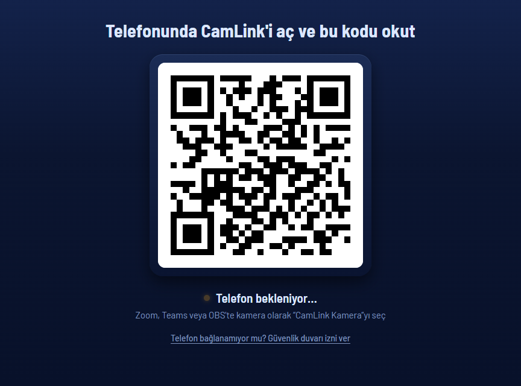
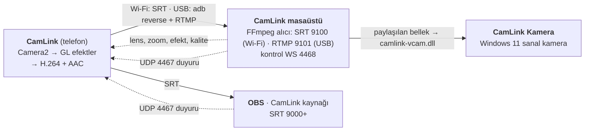

# CamLink

CamLink, Android telefonunu Windows'ta web kamerası yapar. QR kodu bir kez okutursun, sonra telefon kendiliğinden bağlanır. Masaüstü uygulaması açık olduğu sürece "CamLink Kamera", kamera seçebilen her uygulamada listelenir. Kablo takılıysa görüntü USB'den, değilse Wi‑Fi'den gelir; bunu uygulama kendisi seçer.

<p align="center">
  <a href="https://github.com/MihrimatriX/camlink/releases/latest/download/CamLink-win-Setup.exe"><b>Windows için indir</b></a> ·
  <a href="https://github.com/MihrimatriX/camlink/releases/latest/download/CamLink.apk"><b>Android APK</b></a> ·
  <a href="https://mihrimatrix.github.io/camlink/">Tanıtım sayfası</a>
</p>



## Nasıl kullanılır

1. Bilgisayara CamLink-win-Setup.exe'yi kur ve aç. Pencerede büyük bir QR kod görünür. CamLink Kamera henüz kurulu değilse pencerede **Kur** düğmesi çıkar (bir kez yönetici izni ister).
2. Telefona CamLink.apk'yı kur, kamera ve mikrofon izni ver. **Bilgisayara bağlan** kartına dokunup QR kodu okut. Yayın kendiliğinden başlar.
3. Kamera seçebilen uygulamada (OBS, tarayıcı, Zoom, Teams gibi) **CamLink Kamera**'yı seç. Sonraki açılışlarda QR gerekmez.

USB ile bağlanmak için telefonda USB hata ayıklamayı aç (Ayarlar › Geliştirici seçenekleri) ve kabloyu tak. Kabloyu çıkarınca bağlantı Wi‑Fi'ye geçer.

## Neler var

- Gecikme düşük. Telefon görüntüyü kendi donanımıyla H.264 biçiminde sıkıştırır (B-kare yok, saniyede bir anahtar kare). Ses aygıtı yokken görüntü telefondan ekrana yaklaşık 0,23 saniyede gelir.
- CamLink Kamera 640×360 ile 4K (3840×2160) arasında 13 mod sunar (30 ya da 60 fps). Kamerayı kullanan uygulama büyük bir mod seçerse masaüstü telefondan o kaliteyi ister. Telefon yalnız kamerasının ve kodlayıcısının kaldırdığı modları gösterir.
- Telefonu bilgisayardan yönetebilirsin: lens, yakınlaştırma, efekt, pozlama, beyaz dengesi, görüntü sabitleme, kalite ve mikrofon.
- Telefon ekranı sade: bir durum yazısı, lens seçimi ve üç düğme (Çevir, Mikrofon, Karart). Telefon yatay tutulunca da düzgün görünür.
- [VB-Cable](https://vb-audio.com/Cable/) kuruluysa telefonun mikrofonu bilgisayarda mikrofon olur.
- OBS eklentisi, OBS'e "CamLink telefon kamerası" adlı bir kaynak ekler. Telefonlar bilgisayarı yerel ağda kendileri bulur.
- Bağlantı koparsa uygulama kendiliğinden yeniden bağlanır. USB ile Wi‑Fi arasında da kendisi geçer.
- Ön ve arka kamera aynı anda kullanılabilir (resim içinde resim). Ayrıca 17 görüntü efekti, dikey (9:16) yayın, ekran karartma, ısınma ve pil uyarısı var.

## Nasıl çalışır



Sanal kamera, Frame Server içinde çalışan bir Media Foundation DLL'idir ve Windows 11'in `MFCreateVirtualCamera` API'siyle kurulur. FFmpeg telefondan gelen görüntüyü çözer, masaüstü uygulaması kareleri paylaşılan belleğe yazar. DLL bu kareleri, kamerayı açan uygulamanın seçtiği moda ölçekler.

## Bu depoda

| Klasör | Ne | Teknoloji |
|---|---|---|
| [`app/`](app/) | Telefon uygulaması ve yerel kamera/kodlayıcı motoru | Expo SDK 58, React Native 0.88, TypeScript; Kotlin Expo modülü, [RootEncoder](https://github.com/pedroSG94/RootEncoder) 2.8 |
| [`desktop/`](desktop/) | Windows 11 masaüstü uygulaması ve sanal kamera DLL'i | .NET 10 (WPF + WebView2), FFmpeg, C++17 Media Foundation |
| [`obs-plugin/`](obs-plugin/) | OBS kaynağı ve ağ duyurusu | C, libobs 30 API, MinGW-w64 |
| [`scripts/`](scripts/) | Sürüm betiği: APK, kurulum dosyası ve GitHub sürümü | PowerShell 7, Velopack |

Ayrıntılı kullanım ve sorun giderme: [telefon](app/README.md) · [masaüstü](desktop/README.md) · [OBS eklentisi](obs-plugin/README.md).

## Kaynaktan derleme

Gerekenler: telefon için Node.js 20+, JDK 17 ve Android SDK; masaüstü için Windows 11, .NET 10 SDK, PowerShell 7 ve Visual Studio 18 (C++ iş yükü, CMake); OBS eklentisi için MinGW-w64 (Linux ya da MSYS2).

```powershell
# Telefon (yerel modül içerir, Expo Go'da çalışmaz)
cd app; npm ci; npm run typecheck
npx expo run:android                     # bağlı telefona kurar

# Masaüstü
pwsh desktop/scripts/ffmpeg-indir.ps1    # FFmpeg → desktop/vendor/ffmpeg
pwsh desktop/scripts/adb-kopyala.ps1     # adb → desktop/vendor/adb
pwsh desktop/vcam/build.ps1              # sanal kamera DLL'i (kurmak için -Install, UAC)
dotnet test desktop/tests/CamLink.Desktop.Core.Tests
dotnet build desktop/src/CamLink.Desktop

# Sürüm: APK + Setup.exe → dist/ (-Publish ile GitHub'a yükler)
pwsh scripts/release.ps1 -Version x.y.z   # önce app/app.json'daki sürümü değiştir
```

```bash
# OBS eklentisi
cd obs-plugin && ./build.sh              # → out/camlink/bin/64bit/camlink.dll
```

## Durum

Gerçek bir telefonla (Huawei SNE-LX1, Android) ve Windows 11 ile denenenler: QR ile eşleşme, kendiliğinden yeniden bağlanma, USB ve Wi‑Fi yolu, 640×480'den 4K'ya sanal kamera modları, OBS'in kamerayı okuması.

Henüz denenmeyenler: ekran kapalıyken yayın, Teams ve Zoom, VB-Cable ile mikrofon, Windows'taki OBS'te eklenti, Windows 10 (sanal kamera Windows 11 ister).

## Lisans

Tüm hakları saklıdır. Üçüncü taraf bileşenler kendi lisanslarıyla gelir:

| Bileşen | Lisans |
|---|---|
| [RootEncoder](https://github.com/pedroSG94/RootEncoder) | Apache 2.0 |
| [FFmpeg](https://ffmpeg.org) (kurulum dosyasında ayrı program olarak; kaynak: `desktop/vendor/ffmpeg/KAYNAK.txt`) | GPL v3 |
| adb ([Android SDK platform-tools](https://developer.android.com/tools/releases/platform-tools)) | Apache 2.0 |
| [OBS Studio](https://github.com/obsproject/obs-studio) libobs başlıkları (derlemede indirilir) | GPL v2+ |
| [Barlow](https://github.com/jpt/barlow) yazı tipi | SIL OFL 1.1 |

OBS eklentisi libobs'a bağlandığı için eklentinin derlenmiş dosyası dağıtılırsa GPL koşullarına tabi olur. Sürümlerde bu dosya yok.

Kardeş depo: [deckpad](https://github.com/MihrimatriX/deckpad), telefonu OBS için Stream Deck'e çeviren uygulama.
